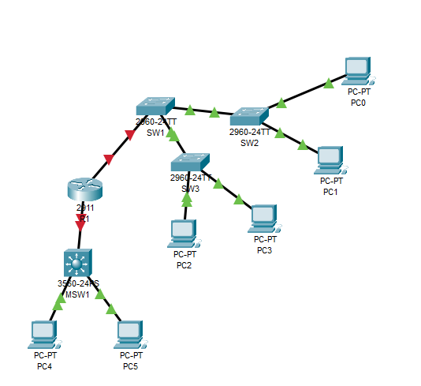
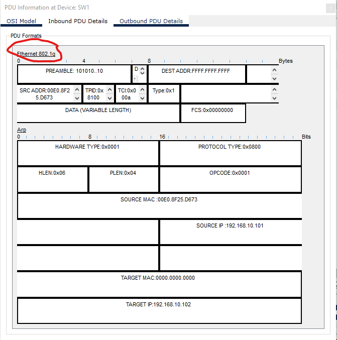

# Отчет по лабораторной работе №3
**Тема:** VLAN, маршрутизация между VLAN
**Выполнил:** Мазов С. М., гр. 409

## Топология



## Ответы на вопросы

1. Вывод команды show vlan brief на SW2:
```
VLAN Name                             Status    Ports
---- -------------------------------- --------- -------------------------------
1    default                          active    Fa0/3, Fa0/4, Fa0/5, Fa0/6
                                                Fa0/7, Fa0/8, Fa0/9, Fa0/10
                                                Fa0/11, Fa0/12, Fa0/13, Fa0/14
                                                Fa0/15, Fa0/16, Fa0/17, Fa0/18
                                                Fa0/19, Fa0/20, Fa0/21, Fa0/22
                                                Fa0/23, Gig0/1, Gig0/2
10   10                               active    Fa0/1
20   20                               active    Fa0/2
99   99                               active    
1002 fddi-default                     active    
1003 token-ring-default               active    
1004 fddinet-default                  active    
1005 trnet-default                    active
```
Вывод команды show vlan id 10 на SW2:
```
VLAN Name                             Status    Ports
---- -------------------------------- --------- -------------------------------
10   10                               active    Fa0/1

VLAN Type  SAID       MTU   Parent RingNo BridgeNo Stp  BrdgMode Trans1 Trans2
---- ----- ---------- ----- ------ ------ -------- ---- -------- ------ ------
10   enet  100010     1500  -      -      -        -    -        0      0
```
Вывод команды show interfaces trunk на SW1:
```
Port        Mode         Encapsulation  Status        Native vlan
Fa0/24      on           802.1q         trunking      99

Port        Vlans allowed on trunk
Fa0/24      10,20

Port        Vlans allowed and active in management domain
Fa0/24      10,20

Port        Vlans in spanning tree forwarding state and not pruned
Fa0/24      10,20
```
2. Кроме отличия, что одна вкладка - это входящий пакет, а другая исходящий. Отличий не найдено.

Заголовок Ethernet из Outbound PDU Details:



Значение поля TCI = 0x000a. В десятичной системе счисления, она будет равна 10.
 
3. PC0 - VLAN 10. PC1 - VLAN 20. Коммутатор рассылает широковещательный кадр во все порты
того же VLAN, кроме порта-источника. В порты других VLAN кадр не уходит из-за изоляции широковещательных доменов,
поэтому SW2 не отправил ARP Request в сторону PC1.

4. Вывод команды ping между PC0 и PC1:
```
Pinging 192.168.20.101 with 32 bytes of data:

Reply from 192.168.20.101: bytes=32 time<1ms TTL=127
Reply from 192.168.20.101: bytes=32 time<1ms TTL=127
Reply from 192.168.20.101: bytes=32 time=1ms TTL=127
Reply from 192.168.20.101: bytes=32 time<1ms TTL=127

Ping statistics for 192.168.20.101:
    Packets: Sent = 4, Received = 4, Lost = 0 (0% loss),
Approximate round trip times in milli-seconds:
    Minimum = 0ms, Maximum = 1ms, Average = 0ms
```
Вывод команды show ip interface brief на R1:
```
Interface              IP-Address      OK? Method Status                Protocol 
GigabitEthernet0/0     unassigned      YES unset  up                    up 
GigabitEthernet0/0.10  192.168.10.1    YES manual up                    up 
GigabitEthernet0/0.20  192.168.20.1    YES manual up                    up 
GigabitEthernet0/1     unassigned      YES unset  administratively down down 
GigabitEthernet0/2     unassigned      YES unset  administratively down down 
Vlan1                  unassigned      YES unset  administratively down down
```
Вывод команды show mac address-table на SW1:
```
          Mac Address Table
-------------------------------------------

Vlan    Mac Address       Type        Ports
----    -----------       --------    -----

  10    0010.112d.bd01    DYNAMIC     Gig0/1
  10    00e0.8f25.d673    DYNAMIC     Fa0/23
  20    0010.112d.bd01    DYNAMIC     Gig0/1
  20    0030.a301.a87d    DYNAMIC     Fa0/23
```
В таблице MAC-адресов SW1 отображаются две записи с одинаковыми MAC-адресами R1, т.к. 
оба сабинтерфейса работают поверх одного физического и используют единый аппаратный адрес.
Отличаются они только номерами VLAN.

5. Вывод команды ping
```
Pinging 192.168.10.101 with 32 bytes of data:

Reply from 192.168.10.101: bytes=32 time<1ms TTL=126
Reply from 192.168.10.101: bytes=32 time=8ms TTL=126
Reply from 192.168.10.101: bytes=32 time<1ms TTL=126
Reply from 192.168.10.101: bytes=32 time<1ms TTL=126

Ping statistics for 192.168.10.101:
    Packets: Sent = 4, Received = 4, Lost = 0 (0% loss),
Approximate round trip times in milli-seconds:
    Minimum = 0ms, Maximum = 8ms, Average = 2ms
```
Вывод команды show ip interface brief на MSW1:
```
Interface              IP-Address      OK? Method Status                Protocol 
FastEthernet0/1        unassigned      YES unset  up                    up 
FastEthernet0/2        unassigned      YES unset  up                    up 
FastEthernet0/3        unassigned      YES unset  down                  down 
FastEthernet0/4        unassigned      YES unset  down                  down 
FastEthernet0/5        unassigned      YES unset  down                  down 
FastEthernet0/6        unassigned      YES unset  down                  down 
FastEthernet0/7        unassigned      YES unset  down                  down 
FastEthernet0/8        unassigned      YES unset  down                  down 
FastEthernet0/9        unassigned      YES unset  down                  down 
FastEthernet0/10       unassigned      YES unset  down                  down 
FastEthernet0/11       unassigned      YES unset  down                  down 
FastEthernet0/12       unassigned      YES unset  down                  down 
FastEthernet0/13       unassigned      YES unset  down                  down 
FastEthernet0/14       unassigned      YES unset  down                  down 
FastEthernet0/15       unassigned      YES unset  down                  down 
FastEthernet0/16       unassigned      YES unset  down                  down 
FastEthernet0/17       unassigned      YES unset  down                  down 
FastEthernet0/18       unassigned      YES unset  down                  down 
FastEthernet0/19       unassigned      YES unset  down                  down 
FastEthernet0/20       unassigned      YES unset  down                  down 
FastEthernet0/21       unassigned      YES unset  down                  down 
FastEthernet0/22       unassigned      YES unset  down                  down 
FastEthernet0/23       unassigned      YES unset  down                  down 
FastEthernet0/24       unassigned      YES unset  down                  down 
GigabitEthernet0/1     10.0.0.2        YES manual up                    up 
GigabitEthernet0/2     unassigned      YES unset  down                  down 
Vlan1                  unassigned      YES unset  administratively down down 
Vlan30                 192.168.30.1    YES manual up                    up 
Vlan40                 192.168.40.1    YES manual up                    up
```
Вывод команд show ip route на MSW1:
```
Codes: C - connected, S - static, I - IGRP, R - RIP, M - mobile, B - BGP
       D - EIGRP, EX - EIGRP external, O - OSPF, IA - OSPF inter area
       N1 - OSPF NSSA external type 1, N2 - OSPF NSSA external type 2
       E1 - OSPF external type 1, E2 - OSPF external type 2, E - EGP
       i - IS-IS, L1 - IS-IS level-1, L2 - IS-IS level-2, ia - IS-IS inter area
       * - candidate default, U - per-user static route, o - ODR
       P - periodic downloaded static route

Gateway of last resort is not set

     10.0.0.0/30 is subnetted, 1 subnets
C       10.0.0.0 is directly connected, GigabitEthernet0/1
S    192.168.10.0/24 [1/0] via 10.0.0.1
C    192.168.30.0/24 is directly connected, Vlan30
C    192.168.40.0/24 is directly connected, Vlan40
```
